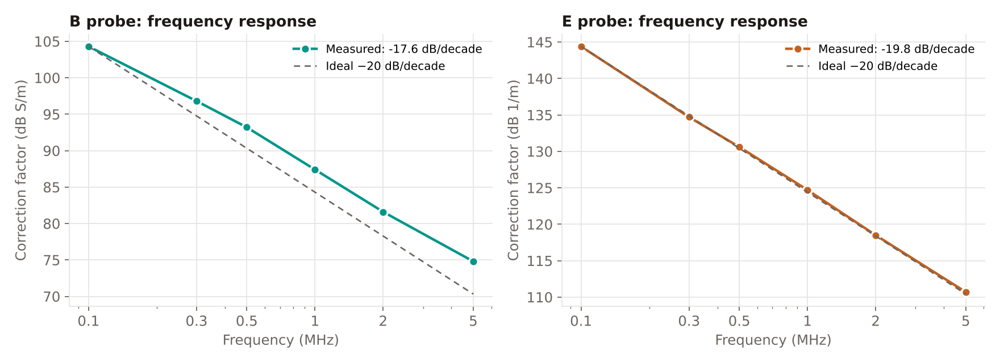
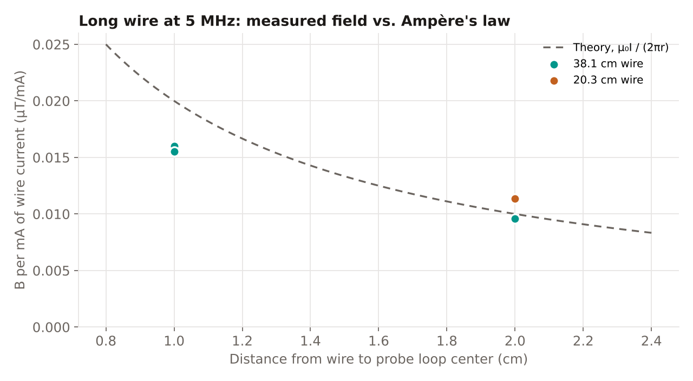

**Goal:** calibrate a magnetic (B) and an electric (E) near-field probe from 100 kHz to 5 MHz, then use the B probe to measure a field I could also calculate.

Near-field probes are the standard tool for EMC pre-compliance. Before a product goes to a certified lab for radiated-emissions testing, engineers sweep a probe over the board to find which trace, cable or chip is radiating. Out of the box a probe only reports a power on a spectrum analyzer, which says *where* the field is strong but not *how* strong. A calibration curve turns that reading into a field in A/m or V/m that can be compared against a limit.

## Known fields to calibrate against

For the B probe I used a 75-turn Helmholtz coil, whose center field is B₀ ≈ 0.7155 μ₀NI/R, or about 5,370 A/m per amp. The coil's inductance (about 0.16 mH) means its reactance passes the generator's 50 Ω near 50 kHz, so the drive current falls off with frequency. Rather than trust the generator setting, I measured the coil current across a sense resistor on the oscilloscope and computed the field from that. For the E probe, two parallel plates 0.8 cm apart give E = V/d from the measured plate voltage.

Every measurement went through the same chain: probe, SMA cable, a ZFL-1000LN low-noise amplifier, and a spectrum analyzer. At each frequency I stepped the generator from +15 to −20 dBm and fitted field against analyzer power.

The plot at the top of this page shows the result. A slope of 1 means a 1 dB rise in field gives a 1 dB rise in power, which is what a linear probe should do. Both probes came out linear, with slopes between 0.99 and 1.05 and R² above 0.999 wherever the signal was well clear of the noise floor. The exception was the E probe at 100 kHz. Both probes put out a voltage proportional to frequency, so at 100 kHz the signal is 34 dB weaker than at 5 MHz for the same field, and only the top three points cleared the noise. That's a sensitivity limit of the setup rather than an error; a narrower resolution bandwidth or trace averaging would help.

## Frequency response

Because a loop's output follows Faraday's law (V = ωμ₀HA) and a short monopole couples through a small capacitance, both probes should need 20 dB less correction for every decade of frequency.

The E probe landed almost exactly on theory at −19.8 dB/decade. As a cross-check, the plate voltage held at 1.31 ± 0.01 V across the whole sweep while the probe output rose 34.5 dB over the 50× frequency range, against the 34.0 dB a capacitive probe should give. The B probe was flatter at −17.6 dB/decade. Since the field came from measured current, the coil's inductance can't explain it; the likely causes are the coil's self-resonance near 5 MHz and the probe loop's own response departing from ideal at the low end.

## Checking it on a long wire

To test the calibration on something it had never seen, I drove a straight wire at 5 MHz through an 11.1 Ω sense resistor and laid the B probe flat beside it, where Ampère's law predicts B = μ₀I / (2πr).

At 2 cm the measurement landed within −0.4 dB and +1.1 dB of theory, and at 1 cm within −2.2 dB. The biggest error wasn't any instrument. The probe's loop sits hidden inside its tip, and at 1 cm a 1.5 mm placement error changes the expected field by about 15%. One 1 cm retake came out 8 dB high, which implies the loop was only about 4 mm from the wire, so I treated it as a placement error and left it out. The finite wire and the return current about 20 cm away also pull the true field slightly below the ideal formula, by roughly 0.5–1 dB at these distances.

## Takeaway

With these curves, a reading on the analyzer becomes a field strength at any frequency from 100 kHz to 5 MHz, so "this trace looks noisy" becomes a number you can compare against an emissions limit or track as the design changes. The practical lesson was about the measurement itself: close to a source, a millimeter of probe position matters more than any instrument error, so readings at 2 cm or more are the repeatable ones.

The plots on this page are redrawn from the data in my lab report.
